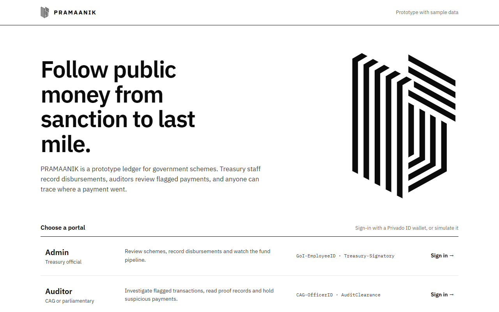
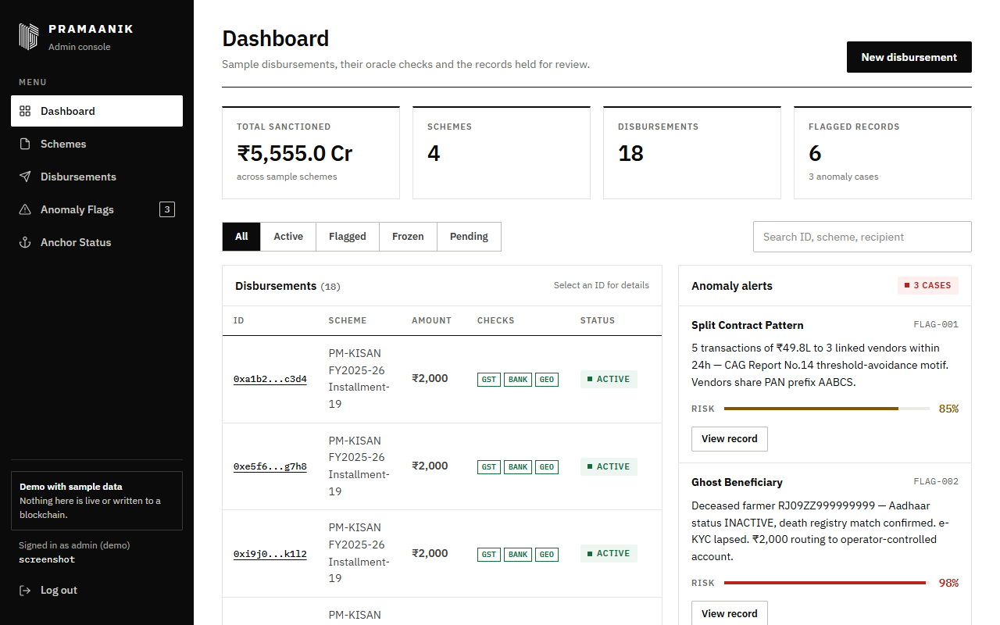
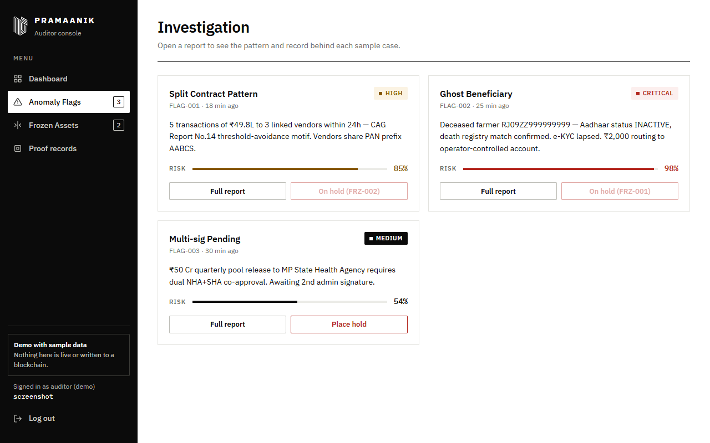
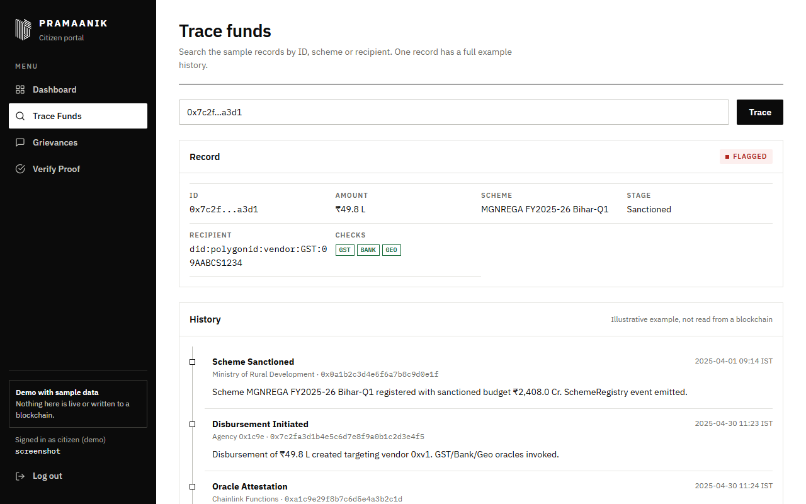

# PRAMAANIK

PRAMAANIK (ChainLedger) is a prototype for following government scheme money from sanction to the last recipient. It combines Solidity contracts that record disbursements and their stages, a graph neural network that scores transaction patterns, and role-based portals for treasury staff, auditors and citizens.

It is a demonstration project. It is not deployed for any government body, is not affiliated with or endorsed by one, and has not had a security audit or a compliance review.

Live demo: <https://pramaanik.vercel.app> (the hosted copy may not match the code on this branch).



## What works today

The web demo in `frontend/` is static HTML, CSS and JavaScript. Every figure on it comes from sample data in `frontend/js/data.js`.

- The portals do not read from or write to a blockchain. Forms add records in the page, and they disappear on reload.
- Transaction IDs, risk scores, proof status, anchor entries, history timelines, people, vendors and findings are illustrative. This includes references to audit reports and government registries inside the sample text. Do not treat any of it as fact.
- Wallet sign-in is simulated. The landing page shows a Privado ID (iden3comm) request as a QR code, and "Continue with simulated sign-in" opens a portal without checking a proof. Sessions live in `localStorage` and are checked only in the browser.

The contracts and backend services are separate pieces. The static demo is not connected to them.

| Admin | Auditor |
|---|---|
|  |  |



## Run the web demo

Requires Python 3. There is no build step.

```bash
git clone https://github.com/harctik/pramaanik.git
cd pramaanik
python -m http.server 8000 --bind 127.0.0.1 --directory frontend
```

Open <http://127.0.0.1:8000>. Web fonts load from Google Fonts.

Vercel serves the same `frontend/` folder (see `vercel.json`).

`server.js` is an alternative Node server on port 3333. It listens on all network interfaces, tries to open a public ngrok tunnel, and its sign-in callback marks any POSTed session as verified. Do not expose it to a network you do not trust.

### Local test sign-in

When the static site is opened on `localhost`, `127.0.0.1`, `[::1]` or a `*.localhost` name, the landing page also shows a test sign-in form. It opens the Admin portal with sample data. The form is hidden on other hosts, including the live demo. The test credentials are in the script in `frontend/index.html`.

This is a convenience for local testing, not access control. The check runs entirely in the browser, and the portals already rely on a simulated session. Do not reuse these credentials anywhere.

## Smart contracts

The sources are in `contracts/src` (Solidity 0.8.24, OpenZeppelin upgradeable libraries). `contracts/script/Deploy.s.sol` deploys the first eight.

| Contract | What the code does |
|---|---|
| `SchemeRegistry` | Registers schemes. Rejects a recorded disbursement if the scheme is not active or the amount would exceed its budget. An auditor can freeze a scheme. |
| `FundFlow` | Admins create disbursements, and the receiver's government level must be below the sender's. Enforces a stage transition table. Larger amounts need approval from two admin accounts before `advanceStage`. An oracle role can flag records, and an auditor can freeze them. GST, bank and geotag results are stored as supplied by the caller and are not enforced. |
| `AccessGovernance` | Registry of DID strings, credential hashes and roles, with deactivation. The other contracts keep their own roles and do not consult it. |
| `AnomalyOracle` | Stores model hashes and predictions. Requires an external proof verifier, which is not in this repository. `Deploy.s.sol` leaves it unset, so submissions revert until one is configured. |
| `BatchVerifier` | Stores Merkle roots of proof batches and checks inclusion. With no verifier address it accepts every batch (mock mode). Its gas-saved figure is a fixed estimate, not a measurement. |
| `Anchor` | Stores Merkle checkpoints and records references to publications on other chains. |
| `ConstitutionalCompliance` | Holds five rule labels. An authorised account records violations and escalations by hand. Nothing is checked automatically, and no external authority or filing system is contacted. |
| `GrievancePortal` | Filing, acknowledgement, review, resolution and escalation of grievances. Anyone can trigger escalation of an unacknowledged grievance after 72 hours. Assisted filing stores a nullifier without verifying a zero-knowledge proof. |
| `GrievancePaymaster` | Stub, not deployed. It approves every sponsorship request. Do not fund it. |

See [Known issues](#known-issues) before relying on any of these rules.

### Build and test

Requires [Foundry](https://book.getfoundry.sh/). The Solidity dependencies are not vendored and no remappings are committed. The following is a suggested setup and has not been run for this README.

```bash
cd contracts
forge install --no-git foundry-rs/forge-std \
  OpenZeppelin/openzeppelin-contracts@v5.1.0 \
  OpenZeppelin/openzeppelin-contracts-upgradeable@v5.1.0
printf '%s\n' \
  '@openzeppelin/contracts-upgradeable/=lib/openzeppelin-contracts-upgradeable/contracts/' \
  '@openzeppelin/contracts/=lib/openzeppelin-contracts/contracts/' \
  'forge-std/=lib/forge-std/src/' > remappings.txt
forge build
forge test
```

`contracts/test` holds 40 test functions, three of them fuzz tests, with 10,000 fuzz runs configured in `foundry.toml`. No test results or coverage report are committed. The CI workflow calls `forge install` without naming dependencies, so check its status before relying on it.

To deploy, set `PRIVATE_KEY` and `BESU_RPC_URL`, then run the following from `contracts/`. The deploy script does not create proxies.

```bash
forge script script/Deploy.s.sol --broadcast --rpc-url $BESU_RPC_URL
```

`script/SeedDemo.s.sol` adds sample records after deployment. Its header lists how to run it, and it reads the contract addresses from environment variables.

## Anomaly model

`services/gnn/main.py` defines a relational graph convolutional network with PyTorch Geometric: three `RGCNConv` layers, 16 input features, 64 hidden units, five relation types, batch normalisation after the first two layers, dropout 0.3 and a sigmoid output.

No model checkpoint is committed. Unless `MODEL_CHECKPOINT` points to one, the service trains on synthetic data at startup. The accuracy it logs then is measured on the training data, and if a checkpoint is loaded, the reported accuracy is a fixed value in the code. The explanation text is chosen from preset strings by score, so it is not evidence that a particular fraud pattern was found. The drift figure labelled PSI is a normalised shift in means. The shell-company check is a separate in-memory rule score.

### Held-out evaluation

These results are committed in [`services/gnn/eval/results.json`](services/gnn/eval/results.json) and produced by [`rgcn_heldout_eval.py`](services/gnn/eval/rgcn_heldout_eval.py): 5 seeds, a 70/15/15 split, with the epoch chosen by validation F1.

| Metric | Mean | Std |
|---|---|---|
| Precision | 0.935 | 0.050 |
| Recall | 0.973 | 0.014 |
| F1 | 0.953 | 0.028 |
| ROC-AUC | 0.999 | 0.001 |

All data is synthetic (Gaussian features on a chain graph), and the evaluation is transductive. The script trains its own copy of the architecture and shuffles node order, unlike the service. The numbers show that the pipeline learns the generator's signal. They say nothing about performance on real disbursement data. See the [evaluation notes](services/gnn/eval/README.md).

With `numpy`, `torch`, `torch-geometric` and `scikit-learn` installed:

```bash
python services/gnn/eval/rgcn_heldout_eval.py
```

## Other services

| Path | State |
|---|---|
| `services/oracle` | Express endpoints for GST, bank-account and geotag checks. Without API settings they return mock answers. The external integrations have not been verified against any real service. |
| `services/zkml` | Redis worker and HTTP API that call EZKL. No ONNX model is committed. `DEMO_MODE=true` returns placeholder bytes, not a proof. |
| `services/anchor` | Listens for checkpoint events and publishes them to mirror contracts on Polygon Amoy and every tenth one to Sepolia. The mirror contracts are not in this repository, and this service does not create checkpoints. |
| `services/storage` | Encrypts uploads with AES-256-GCM and stores them on IPFS. Its encryption metadata is held in memory. Without `STORAGE_MASTER_KEY`, a new random key is generated at each start. |
| `services/common/kms.ts` | Key-provider scaffolding. The AWS KMS signing path is not implemented. |
| `apps/web` | Next.js 16 and React 19 version of the portals. It was not part of the redesign shown above. Run it with `npm ci` and `npm run dev` from that folder (not tested for this README). |

`docker-compose.yml` describes a four-validator Hyperledger Besu QBFT network (chain ID 1337, 2-second blocks) alongside the services, IPFS, Neo4j, Redis, Prometheus and Grafana. **The full stack does not currently start with one command:** the `web` service expects `apps/web/Dockerfile`, which does not exist. The rest of the stack has not been tested for this README.

The validator keys in `besu-config/` are committed to a public repository. Treat them as compromised and use them only on a throwaway local network. Never commit a `.env` file or a real private key; `.env.example` lists the variables.

## Known issues

Found by reading the code. They are not fixed here.

- **Approval threshold:** `FundFlow.MULTISIG_THRESHOLD` is `500000000` paisa, which is Rs 50 lakh, although the comment says Rs 5 crore.
- **Approvals:** any two `ADMIN_ROLE` accounts qualify, including the creator. There is no fixed set of three signers. `submitUtilizationCert` bypasses the approval check, and `verifyUtilizationCert` does not require a pending certificate.
- **Deployment:** the script passes the `AnomalyOracle` address as the batch verifier, although it lacks the expected function. UUPS contracts are deployed without proxies, so upgrades will not work.
- **Oracle:** a prediction's proof is not bound to its disbursement ID or score. A failed flag call is ignored. The oracle's flag threshold (5000) differs from the score at which `FundFlow` changes stage (7500).
- **Scheme freeze:** an admin can undo an auditor's freeze through `setSchemeStatus`.
- **Seed data:** several large amounts in `SeedDemo.s.sol` are 100 times the rupee values in their comments.
- **zkML worker:** its Dockerfile does not install FastAPI or Uvicorn. The retry marker is dropped when a job is parsed, so a job that keeps timing out can be re-queued indefinitely.
- **GNN API:** `/predict` turns its own 422 errors into 400 responses.
- **Monitoring:** Prometheus targets a `besu` host that Compose does not define, and only the first Besu node enables HTTP RPC.

## Repository layout

```
frontend/       static web demo (deployed by vercel.json)
contracts/      Solidity sources, tests and scripts
services/       gnn, zkml, oracle, anchor, storage, common
apps/web/       Next.js portals
besu-config/    local network genesis and development keys
config/         Prometheus and alert configuration
data/           synthetic data generator
docs/           notes and screenshots
```

## Design documents

[Architecture](ARCHITECTURE.md), [security notes](SECURITY.md), [research report](RESEARCH_REPORT.md), [judges' document](PRAMAANIK_JUDGES_DOCUMENT.md), [threat model](docs/threat-model.md), [DPDP notes](docs/dpdp-compliance.md), [disaster recovery](docs/disaster-recovery.md) and [demo script](docs/demo-script.md).

These describe design intent and targets, and were not checked against the code for this README. Where they differ from the code, the code is accurate. Nothing in them is a certification or a statement of legal or regulatory compliance.

## Team

Built by Harctik (BCA Sem 6, U03BV23S0127) and team for the Cybersecurity & Blockchain track, Problem Statement 1: Public Fund Flow Tracking.

Team repository link: <https://github.com/Clueless-Coderz/pramaanik>

## License

[Apache License 2.0](LICENSE).
